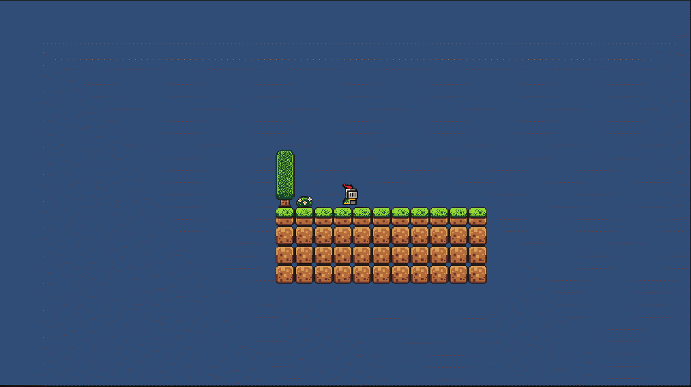
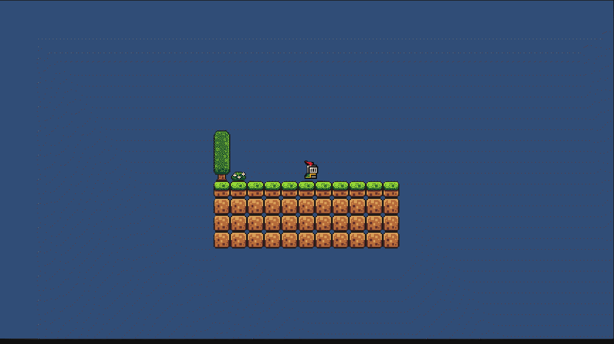
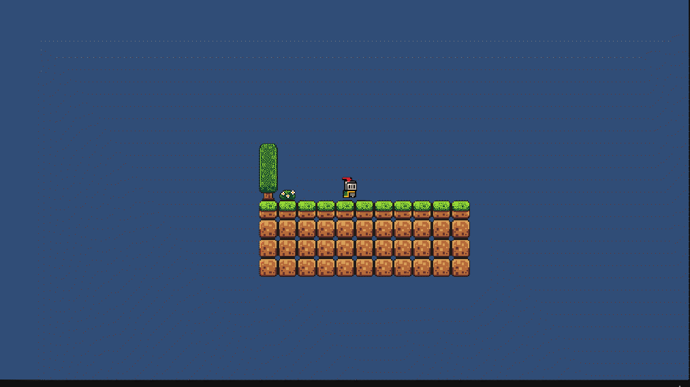

# Mecánicas 2D

## Salto
> Recupera el Rigidbody2D del objeto y aplica una fuerza vertical al objeto cuando se pulse la tecla que hayas configurado para el salto en el Input. Manager

Se ha preparado un pequeño mapa que se irá modificando a lo largo de esta práctica:


Al igual que para el movimiento a lo largo del eje X, se ha utilizado una refencia a la acción saltar del input system. En este caso, en lugar de tomar el valor, se observa cuándo ha sido presionado y se activa un flag que se procesa en el bucle de físicas:

```cs
void Update()
{
    _direction = _moveAction.action.ReadValue<float>();
    if (_jumpAction.action.WasPressedThisFrame())
    {
        _jumpRequested = true;
    }
    UpdateSprite();
}

void FixedUpdate()
{
    _rb.linearVelocityX = _direction * _speed;

    if (_jumpRequested == true)
    {
        _rb.AddForce(transform.up * _thrust, ForceMode2D.Impulse);
        _jumpRequested = false;
    }
}
```

Como resultado, el jugador puede saltar una cantidad establecida:



El principal inconveniente es que cada vez que se pulse el botón, el salto se repite, por lo que puede subir alturas que no estaban pensadas. Esto se corrige en el siguiente apartado.

> En este apartado se debe agregar el código que maneja que sólo se salte si el jugador está en el suelo. Para ello se deben agregar una etiqueta al suelo, de forma que nos permita identificarlo y mediante una variable que actuará de flag, activar o desactivar el salto.

Para ello, se ha añadido otra variable que indique si el personaje está satando en ese momento y se ha movido la condición de finalización a la detección del suelo:

```cs
void FixedUpdate()
{
    _rb.linearVelocityX = _direction * _speed;

    if (_jumpRequested == true && !_isJumping)
    {
        _rb.AddForce(transform.up * _thrust, ForceMode2D.Impulse);
        _isJumping = true;
    }
}

private void OnCollisionEnter2D(Collision2D collision)
{
    if (collision.collider.CompareTag("Floor"))
    {
        _isJumping = false;
        _jumpRequested = false;
        _rb.linearVelocity = new Vector2(_rb.linearVelocityX, 0);
    }
}
```

Al tilemap de fondo se le ha puesto el tag Floor y como resultado, el personaje solo puede saltar cuando toca el suelo:



> Opcional: Verificar si está en el suelo utilizando un Raycast. Para ello, lanzar el rayo desde los pies del jugador hasta el suelo, y si hay impacto con un objeto en la capa suelo en un rango muy corto, se considera que el jugador está en el suelo.

Se ha reorganizado un poco el código para que la petición de salto no se pueda activar mientras está saltando, y aplicando un raycast debajo del collider del jugador se obtiene el mismo resultado que anteriormente:

```cs
void Update()
{
    _direction = _moveAction.action.ReadValue<float>();
    if (_jumpAction.action.WasPressedThisFrame() && !_isJumping)
    {
        _jumpRequested = true;
    }

    _raycastOrigin = new Vector2(_collider.bounds.center.x, _collider.bounds.min.y);
    RaycastHit2D hit = Physics2D.Raycast(_raycastOrigin, -transform.up, _checkDistance, _floorLayer);

    if (hit.collider != null && hit.collider.CompareTag("Floor"))
    {
        _isJumping = false;
        _rb.linearVelocity = new Vector2(_rb.linearVelocityX, 0);
    }

    UpdateSprite();
}
```




## Mécánicas relacionadas con plataformas

> Salto a una plataforma: Esta mecánica se consigue con objetos físicos puesto que hay que implementar un salto, sin embargo, en este caso es necesario detectar la colisión con la plataforma y convertir el sistema de referencia del jugador en hijo de la plataforma. De esta forma conseguiremos que el jugador se mueva sobre/con ella. Del mismo modo una vez que el jugador no esté sobre la plataforma, debemos desvincularla de ella. Esto lo manejaremos cuando se produzca un evento. Desarrollar la versión para plataforma estática y plataforma en movimiento.

> Manejar colisiones con elementos de una capa determinada: Podemos utilizar las capas para que el efecto de las colisiones sólo se tenga en cuenta cuando se pertenece a una determinada capa, o se descarten.

> Plataformas invisibles que se vuelven visibles: Podemos hacer una gestión similar al caso anterior, sólo que en este caso nos interesa manejar los casos en el que se pertenece a la capa de plataformas invisibles. Una vez detectado el caso, se ejecutará la lógica que queramos llevar a cabo, incluido, si así lo consideramos volver la plataforma visible.

> Plataforma que se cae o rompe: El jugador físico, la plataforma cinemática, cuando el jugador salta a la plataforma establecer rigidbody dinámico a la plataforma, con esto conseguiremos que caiga. Activaremos una corrutina de espera: yield return new WaitForSeconds(0.5f); 

> Mecánica de recolección: La recolección de objetos se realiza implementando la lógica de la recolección en alguno de los eventos de colisión con ese objeto. En ocasiones se actualizará la UI, en otras se destruirá el objeto, en otras se mejora alguna característica del personaje. En esta tarea se debe implementar una mecánica en la que el jugador recolecte objetos que le supongan alguna recompensa. En concreto, aumentará su puntuación, al llega a un valor de incremento de puntuación, adquirirá más potencia de salto. La puntuación se mostrará continuamente en la pantalla. El objeto recolectado ya no se usará más.

## Mecánica de disparo 
> Sprite y visibilidad. Crea un GameObject con un sprite para el proyectil. Al iniciar el juego debe estar desactivado (SetActive(false)). Añade un botón de UI que lo active con SetActive(true). Crea una animación Vuelo para el proyectil que se reproduzca al activarse (estado por defecto del Animator). El personaje tendrá sus propias animaciones, con al menos la transición Idle → Dispara mediante un Trigger.

> Jerarquía. Coloca el proyectil como hijo del jugador y comprueba que se mueve con él. Haz que el proyectil avance al activarse. Compara: (a) desactivar el SpriteRenderer (SpriteRenderer.enabled = false) del jugador y (b) desactivar el GameObject del jugador con SetActive(false). ¿Qué ocurre con el proyectil en cada caso? ¿Qué pasa si el jugador se mueve mientras el proyectil vuela?

> Ocultamiento automático. Haz que el proyectil se desactive solo, al cabo de un tiempo (usando una corrutina) o al terminar la animación (usando un Animation Event). Sincroniza el disparo del proyectil con el Trigger Dispara del personaje.

> Prefab e instanciación. Convierte el proyectil en prefab y elimínalo de la escena. Desde el jugador, instáncialo en un punto de disparo al pulsar el botón, sin hacerlo hijo del jugador. Destrúyelo automáticamente con Destroy(gameObject, tiempo) o al chocar.

> Disparo por eventos. Sustituye el botón por al pulsar una tecla o botón Disparo. Además, cuando el jugador colisione con un objeto determinado, debe lanzar un evento. Un componente Lanzador del jugador estará suscrito a ese evento y, al recibirlo, instanciará el proyectil.


